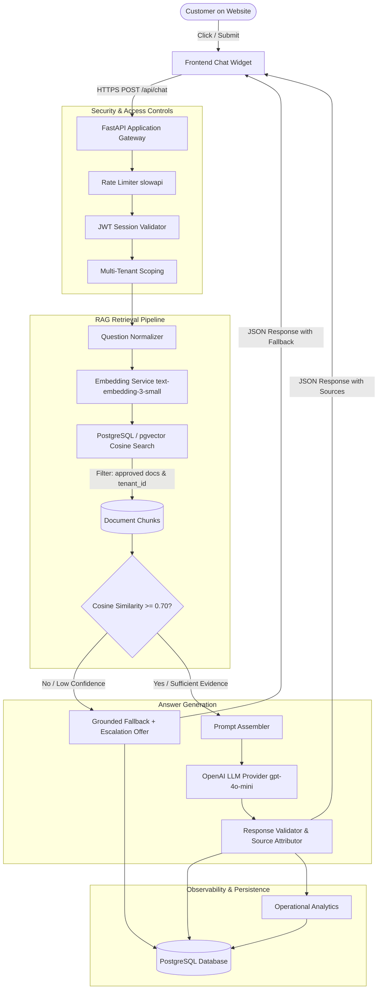
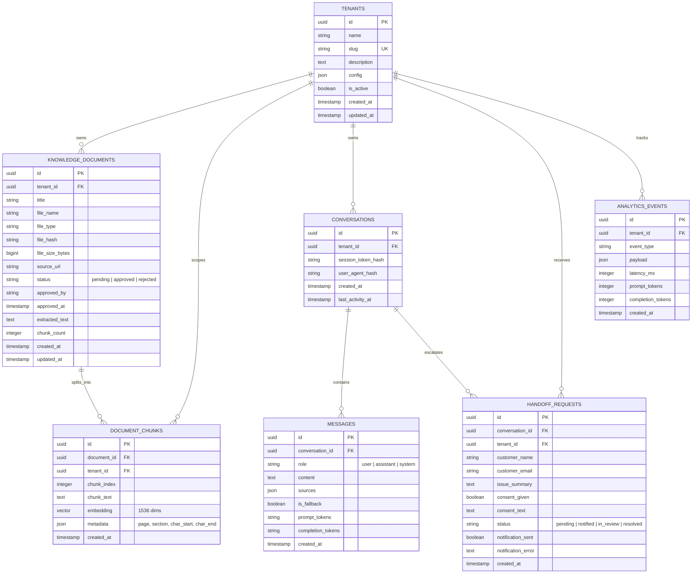

# System Architecture — AI Customer Support Chatbot

## 1. Executive Architecture Overview

The **AI Customer Support Chatbot** is a production-engineered, multi-tenant Retrieval-Augmented Generation (RAG) system. It answers customer inquiries strictly using approved company documentation, provides verified source references with similarity confidence scores, refuses to hallucinate facts outside verified sources by triggering honest fallback notices, and enables consent-driven human agent escalation.

---

## 2. Database Entity-Relationship Diagram (ERD)

Multi-tenancy is enforced at the database schema level. Every document, chunk, conversation, message, and handoff record is bound to a specific `tenant_id`.

---

## 3. Component Breakdown

### 3.1 Website Chat Widget (`frontend/`)
- Pure HTML5, CSS3, and modern ES module JavaScript (`chat.js`).
- Floating toggle button with pulse animation, responsive sliding modal, and unread notification badge.
- Renders user and assistant message bubbles using strict DOM text assignment (`textContent`) to eliminate XSS risks from model outputs.
- Displays expandable source badges containing document title, section, and similarity score.
- Integrated human handoff modal with mandatory consent checkbox.

### 3.2 Application Gateway & API (`app/main.py`, `app/api/`)
- Powered by FastAPI on Uvicorn with structured async request lifecycle.
- Unique `X-Request-Id` generated per HTTP invocation for correlation across logs.
- Strict CORS allowlist prohibiting wildcard access in production environments.
- Rate limiting middleware (`slowapi`) operating on session token keys (with IP fallback).

### 3.3 Security & Session Management (`app/security/`)
- Signed, short-lived JWT session tokens containing conversation ID (`sub`) and tenant ID (`tid`).
- Only SHA-256 digests of session tokens are stored in the database.
- Admin endpoints protected via HTTP Basic Authentication tied to environment credentials.

### 3.4 Ingestion Pipeline (`app/services/ingestion_service.py`, `scripts/`)
- Processes `.txt`, `.md`, and `.pdf` documents.
- Computes SHA-256 content hashes to detect and prevent duplicate uploads.
- Sentence-aware overlapping chunker maintaining context continuity across chunk borders.
- Two-tier approval workflow: documents default to `pending` status and become searchable only when promoted to `approved` by an authorized admin.

### 3.5 Vector Retrieval Pipeline (`app/services/rag_service.py`)
- Question normalization: strips control characters, normalizes whitespace, and truncates query lengths.
- High-dimensional vector search via `pgvector` cosine similarity (`<=>` operator).
- Multi-tenant isolation filter applied directly in SQL WHERE clause (`tenant_id = :tenant_id AND status = 'approved'`).
- Configurable relevance threshold (default `0.70`). If top chunks fall below threshold or no chunks exist, retrieval instantly signals fallback.

### 3.6 Answer Generation & Safety Guardrails (`app/services/llm_service.py`)
- System prompt cleanly separated from user and document contents.
- Document chunks labeled explicitly as data items (`--- CONTEXT 1 ---`), preventing prompt injection attacks from hijacking system behavior.
- Fallback response generated deterministically without invoking LLM completion when context is absent, eliminating hallucinations and saving API costs.
